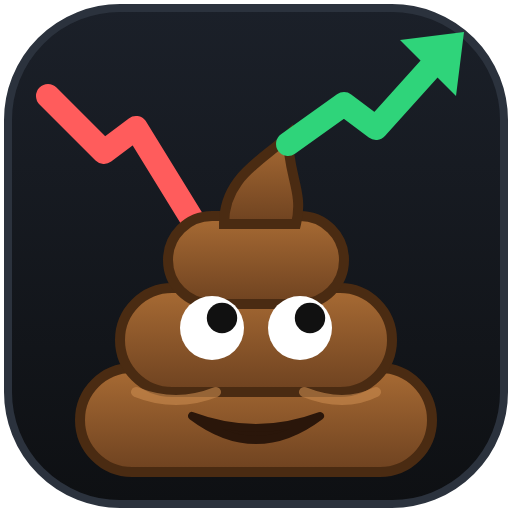
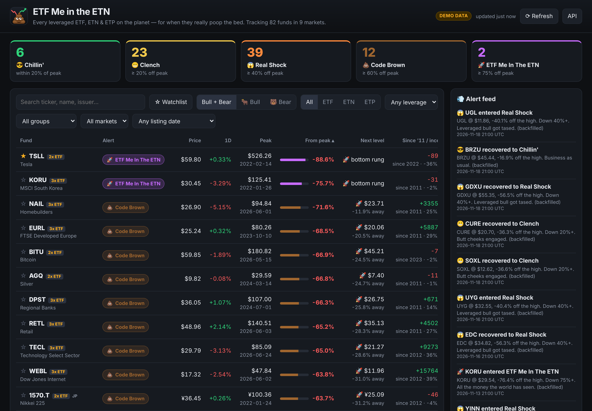

<p align="center"></p>

<h1 align="center">ETF Me in the ETN</h1>
<p align="center"><b>A crash tracker for every leveraged ETF, ETN and ETP, in the US and abroad.</b><br>
It finds every leveraged fund that trades (and every new one the day it lists) and tells you when one has really pooped the bed, because that's when they bounce the hardest.</p>

---

## Why

Leveraged bulls crash hard, but the ones tracking big, durable indexes have come back harder. This app:

* **finds every leveraged ETF / ETN / ETP automatically**: US (Nasdaq, NYSE, NYSE Arca, Cboe) plus London, Xetra, Paris, Amsterdam, Milan, Swiss, Toronto, Hong Kong, Tokyo, Korea, Taiwan, ASX and more. 1.25x to 5x, bull **and** bear, broad market, sectors, single stocks, crypto, commodities, rates, volatility
* **re-scans for new launches** every 12 hours and alerts you when a new leveraged fund lists; funds that close are marked delisted
* pulls **real market data** from Alpaca, Yahoo, Stooq, EODHD, Tiingo, Polygon, FMP or Alpha Vantage, with automatic fallback
* puts each fund on an **alert ladder** based on its drop from the peak
* shows **every past 50%+ crash** and what buying it would have returned 1y and 2y later
* runs a **Monte Carlo forecast** on the fund's own returns, so volatility decay is baked in
* lets you set **price targets** ("TQQQ @ $25: back up the truck") and **pings you** on Discord, Slack, ntfy or any webhook
* exposes an **agent API** so AI agents (local or hosted) can read the data and post their own forecasts

## Screenshots

> Screenshots use the built-in `DEMO_MODE` (synthetic data shaped like TQQQ's real history), so they look the same without internet access.

**The board:** every fund ranked by how far it has fallen, alert-level counts on top, alert feed on the right.



**Fund detail:** price with the crash ladder drawn on, drawdown underneath, crash history, alert-level scorecard, Monte Carlo fan, targets and AI agent takes.


**Phone**


## The alert ladder

Drawdown is measured from the highest close in the last `PEAK_LOOKBACK_YEARS` (default 5).

| Level | Drawdown | Meaning |
|---|---|---|
| 😎 Chillin' | < 20% | Business as usual. |
| 😬 Clench | ≥ 20% | Butt cheeks engaged. |
| 😱 Real Shock | ≥ 40% | Leveraged bull got tased. |
| 💩 Code Brown | ≥ 60% | It took a poop. Start shopping. |
| 🚀 ETF Me In The ETN | ≥ 75% | All the money the world has seen. |

Edit `config/alerts.yaml` to change the levels, names or seeded price targets. Alerts use a 3-point buffer, so a fund sitting right on a line doesn't trigger an alert every day.

The 5-year window is deliberate. Funds that decay over time (oil, natural gas, some single stocks) have split-adjusted all-time highs from ten years ago, so measuring from those would leave them stuck at −99% forever. Set it to `0` to use the true all-time high.

## Quick start

```bash
git clone https://github.com/dannyspace21/ETF-me-in-the-ETN && cd ETF-me-in-the-ETN
cp .env.example .env            # optional
docker compose up -d --build    # http://localhost:8000
```

The first start scans the listing sources and downloads full daily history for every leveraged fund it finds. With a few thousand funds that takes several minutes (the board fills in as it goes). After that it refreshes every `REFRESH_MINUTES` and re-scans for new funds every `DISCOVERY_HOURS`. The SQLite file grows to a few hundred MB with the full global universe.
Your data lives in the `etfme-data` volume (SQLite), so upgrading or recreating the container doesn't lose your targets, alerts or forecasts.

**No internet or just looking around?** `DEMO_MODE=true docker compose up -d`

**Without Docker:**
```bash
pip install -r requirements.txt
uvicorn app.main:app --reload
```

## Deploying & upgrading

* **Image:** every push to `main` and every `v*` tag is tested, then built for `linux/amd64` and `linux/arm64` (Raspberry Pi and Apple Silicon included) and published to `ghcr.io/dannyspace21/etf-me-in-the-etn` as `latest`, `X.Y.Z`, `X.Y` and `sha-…`.
* **Manual upgrade:** `docker compose pull && docker compose up -d`
* **Automatic upgrade:** `docker compose --profile autoupdate up -d` starts Watchtower, which checks for a new image every 6 hours.
* **Pin a version:** `IMAGE=ghcr.io/dannyspace21/etf-me-in-the-etn:1.0.0 docker compose up -d`
* **Release:** `git tag v1.1.0 && git push --tags`
* The container runs as a non-root user, has a `/healthz` healthcheck and reads all its config from environment variables, so it also runs as-is on Fly.io, Railway, Render, Kubernetes, Unraid, Synology and similar.

## Finding every leveraged fund (discovery)

There is no hand-maintained list any more. On startup, and then every `DISCOVERY_HOURS` (default 12), the app pulls the full symbol lists below, keeps every product whose name says it is leveraged (`3X`, `UltraPro`, `Daily (2x) Leveraged`, `-3x Short`, `LevDAX`, `KODEX Leverage`, `Geared` …), works out leverage, bull/bear, issuer, underlying and group, and de-duplicates funds listed on several European venues.

| Source | Key? | What it covers |
|---|---|---|
| `nasdaqtrader` | no | Every US-listed security (Nasdaq, NYSE, NYSE Arca, Cboe BZX). Complete for the US. |
| `alpaca` | free account | Every US asset on Alpaca. |
| `yahoo` | no | Keyword search across world exchanges. Good international coverage, but it is a search, so not guaranteed complete. |
| `eodhd` | key | Full symbol lists of every exchange in `EODHD_EXCHANGES`. **Use this for complete international coverage.** |
| `fmp` | key | FMP's global ETF list. |

Sources without a key are skipped, so the defaults work out of the box: all US funds plus what Yahoo finds abroad. Add an EODHD key to get every international listing.

* **New listings:** after the first scan (the baseline), any new fund fires a `🆕 New leveraged fund` alert and push notification, and the UI marks it **NEW**. Its full price history is pulled right away.
* **Closures:** a fund that has been missing from every complete source that used to list it for `DISCOVERY_DELIST_DAYS` (default 7) is marked delisted and leaves the board. A missed Yahoo search never delists anything.
* **Scope knobs:** `DISCOVERY_INCLUDE_INVERSE=false` for bulls only, `DISCOVERY_MIN_LEVERAGE=2` to drop 1.25x/1.5x funds, `DISCOVERY_COUNTRIES=US,GB,KR` to limit markets.
* `config/universe.yaml` still works for pinning funds with your own metadata, and its `exclude:` list hides tickers for good.
* `POST /api/discovery/run` scans now; `GET /api/discovery` shows the last run, per-source errors and a breakdown by market, leverage and group; `GET /api/funds/new?days=30` lists recent launches.

## Data sources (financial APIs)

Set `DATA_PROVIDERS` to a comma-separated list. They are tried in order until one returns data, and each fund only goes to providers that cover its market.

| Provider | Key? | Markets | Env var |
|---|---|---|---|
| `alpaca` (default, used when keys are set) | free account | US | `ALPACA_API_KEY_ID`, `ALPACA_API_SECRET_KEY` |
| `yahoo` (default) | no | US + international | n/a |
| `stooq` (default) | no | US, UK, DE, FR, JP, HK | n/a |
| `eodhd` (default, used when key is set) | key | US + international | `EODHD_API_KEY` |
| `tiingo` | free key | US | `TIINGO_API_KEY` |
| `polygon` | key | US | `POLYGON_API_KEY` |
| `fmp` (Financial Modeling Prep) | key | US + international | `FMP_API_KEY` |
| `alphavantage` | key | US | `ALPHAVANTAGE_API_KEY` |

Non-US tickers use Yahoo-style suffixes (`QQQ3.L`, `LQQ.PA`, `HQU.TO`, `7226.HK`, `1570.T`, `122630.KS`, `00631L.TW`, `GGUS.AX`), prices are shown in the fund's own currency, and each provider translates the symbol to its own format.

### Alpaca

1. Create a free account at [alpaca.markets](https://alpaca.markets) and generate API keys (paper-trading keys are fine; the app only reads data).
2. Put them in `.env`:
   ```bash
   ALPACA_API_KEY_ID=PK...
   ALPACA_API_SECRET_KEY=...
   ```
3. Restart. Alpaca then handles **discovery of every US asset** and the **daily price updates for all US funds, batched 100 symbols per request**, so thousands of funds refresh in a few calls.

Notes: Alpaca's daily history starts in 2016, so a fund's first full backfill still comes from Yahoo/Stooq/EODHD, and Alpaca keeps it current after that. The free plan can't query the most recent 15 minutes of consolidated (SIP) data; the app asks for SIP up to 16 minutes ago and falls back to the IEX feed if your plan doesn't include SIP (`ALPACA_DATA_FEED=sip|iex`). `ALPACA_PAPER=false` points asset lookups at the live trading API.

### Reverse splits

Leveraged funds reverse-split constantly. Every refresh compares the overlap between stored and freshly fetched prices, and if they disagree by more than 2% the fund's whole history is refetched, so a 1:10 reverse split never shows up as a fake +900% day.

Each provider is about 20 lines in `app/providers/__init__.py`, so adding another is easy.

## AI agents

The app is built so AI agents can read its data and write forecasts back. Machine-readable docs are at **`/docs`** (Swagger) and **`/openapi.json`**.

| Endpoint | What it does |
|---|---|
| `GET /api/agent/manifest` | Tool list in function-calling format; point an agent here first |
| `GET /api/agent/board?min_drawdown=40` | Compact list of all funds, worst first |
| `GET /api/agent/context/{ticker}` | Everything about one fund: summary, ladder prices, crash episodes, scorecard, Monte Carlo, your targets |
| `POST /api/agent/forecasts` | Post a forecast (stance, target, probability, rationale); it shows up in the UI |
| `POST /api/agent/ask` | Ask the server's own LLM about a fund |

```bash
curl -X POST localhost:8000/api/agent/forecasts -H 'Content-Type: application/json' \
  -H "X-API-Key: $KEY" -d '{"agent":"my-bot","ticker":"TQQQ","stance":"accumulate",
  "horizon_days":252,"target_price":60,"probability":55,"rationale":"Down 50%+, history says…"}'
```

`/api/agent/board` takes `direction`, `country`, `group`, `min_lev`, `min_drawdown` and `limit`, so an agent can ask e.g. for "every 3x bull in Korea down 60%+".

Set `AGENT_API_KEYS=key1,key2` to require a key on POST endpoints. Leaving it empty keeps them open, which is fine on a home network but not on the public internet.

### Running the model offline (the default)

"Ask the AI" defaults to **local models**, so nothing leaves your machine:

```bash
docker compose --profile ai up -d
docker compose exec ollama ollama pull llama3.1:8b
# .env:  LLM_PROVIDER=ollama
```

`LLM_PROVIDER=openai` works with **any OpenAI-compatible server**: LM Studio, vLLM, llama.cpp, LocalAI, or hosted ones like OpenAI, OpenRouter and Groq (set `LLM_BASE_URL`, `LLM_MODEL`, `LLM_API_KEY`).
`LLM_PROVIDER=anthropic` uses Claude through the official SDK (`LLM_API_KEY`; the model defaults to `claude-opus-5-5`).

## How the numbers work

* **Peak / drawdown:** split-adjusted closes. **Returns** (since 2011, 1y/2y after a crash) use dividend-adjusted closes.
* **Crash episodes:** a new episode starts when the fund falls X% below its running peak and ends when it closes at a new high. *"Buy at −50%"* is the first close below the line, which you could actually have bought. *"From bottom"* assumes you caught the exact low, which nobody does.
* **Monte Carlo:** a stationary block bootstrap (10-day blocks, 3,000 paths) of the fund's *own* daily log returns. Because it resamples the leveraged fund itself rather than "index × 3", decay, fees and fat tails come along automatically. It's a sanity check, not a crystal ball.

## Project layout

```
app/
  main.py          FastAPI app + REST API
  agents.py        agent API (manifest, context, forecasts, ask)
  discovery.py     finds every leveraged fund (Nasdaq Trader, Alpaca, Yahoo, EODHD, FMP)
  classify.py      fund name -> leverage, bull/bear, issuer, underlying, group
  exchanges.py     ticker suffix <-> exchange, country, currency, provider symbol formats
  llm.py           Ollama / OpenAI-compatible / Anthropic client
  service.py       refresh loop, alert engine, notifications
  analytics.py     drawdowns, tiers, crash episodes, scorecard, Monte Carlo
  providers/       Alpaca (batched), Yahoo, Stooq, EODHD, Tiingo, Polygon, FMP, Alpha Vantage, demo
  static/          single-page UI (vanilla JS + SVG, no CDN), icon.svg
config/            universe.yaml (pinned funds + exclude list), alerts.yaml (ladder + seeded targets)
tests/             pytest
scripts/screenshots.py   regenerates the README screenshots
```

Run the tests with `pip install -r requirements-dev.txt && pytest`.
Regenerate the screenshots with `DEMO_MODE=1 uvicorn app.main:app & python scripts/screenshots.py`.

## Disclaimer

This is a hobby tool and **not financial advice**. Leveraged ETFs reset daily and lose value in sideways, choppy markets. They can and do get closed, and a −90% fund needs +900% to get back to even. ETNs are unsecured debt of the issuer and carry its credit risk. Size your positions accordingly. "All the money the world has seen" is a figure of speech.
